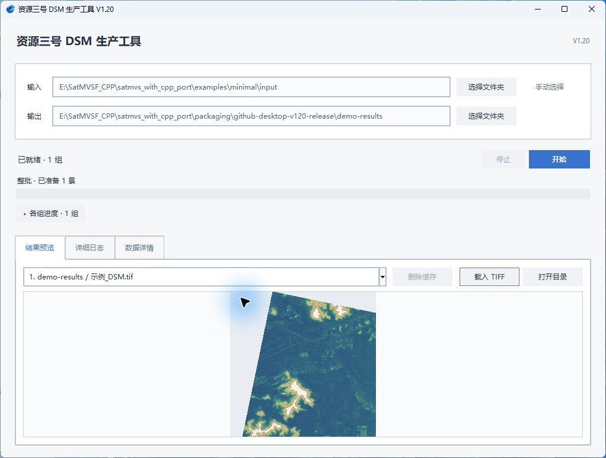

<div align="center">

# 资源三号 DSM 生产工具

**将 BWD / FWD / NAD 三线阵影像，转为带地理参考的数字表面模型。**

Windows 桌面版 · V1.20 · ZY-3 三视图


[**下载 Windows 安装包**](https://github.com/Tian8du/Sat_MVSF/releases/download/desktop-v1.20.0/ZY3DSM_Desktop_v1.20.0_Windows_x64_Setup.exe) · [使用指南](docs/windows-desktop.md) · [全部版本](https://github.com/Tian8du/Sat_MVSF/releases) · [Python 管线](docs/python-pipeline.md)



<sub>实际软件截图，预览区载入已有 DSM；示例输入用于展示操作界面。</sub>

</div>

## 面向生产，保留简单

选择数据文件夹和结果位置，确认参数后开始处理。程序完成数据配对、RPC 预处理、立体匹配和 DSM 生成；进度、日志与成果在同一窗口查看。桌面安装包包含模型与运行环境，无需安装 Python、Conda 或 CUDA Toolkit。

| 能力 | 使用体验 |
| --- | --- |
| 自动组织数据 | 递归扫描文件夹，配对完整的 BWD / FWD / NAD 数据组；也可手动指定三张影像与 RPC。 |
| 运行前确认 | 分辨率、处理块大小、计算设备与过滤参数集中设置，确认后才运行。 |
| 看得见的过程 | 展开每组任务，查看裁剪、匹配、过滤、点云和 DSM 五个阶段的进度与耗时。 |
| 直接查看成果 | 生成 GeoTIFF DSM，内置高程彩色预览；支持载入已有 TIFF。 |
| 续跑与缓存管理 | 未完成组保留缓存以便续跑；每组成功交付后自动清理大体积中间文件。 |
| 独立结果目录 | 原始数据保持只读；最终成果以“数据组名_DSM.tif”保存在所选结果目录。 |

## 三步开始

1. **选择输入**：选择一组数据，或包含多组数据的总文件夹；文件名不规范时使用“手动选择”。
2. **选择输出**：指定与输入目录独立的结果文件夹。
3. **开始生产**：点击“开始”，检查弹出的参数窗口，再点击“确认并开始”。

标准流程：**影像裁剪 → 立体匹配 → 几何过滤 → 流式点云 → DSM**。

<details>
<summary><strong>查看参数窗口与处理模式</strong></summary>

<p align="center">
  
</p>

| 参数方案 | 处理方式 |
| --- | --- |
| 推荐参数 | 标准模式，三视角分别推理并进行几何一致性检测。 |
| 极简模式 | 仍输入三视图，仅以 NAD 为参考推理一次，跳过几何一致性检测。 |
| 2 米 / 5 米输出网格 | 沿用标准模式，调整 DSM 输出像元尺寸。 |

输出网格尺寸不代表高程精度。详细参数、数据命名与续跑说明见[桌面版使用指南](docs/windows-desktop.md)。

</details>

## 下载与环境

在 [Releases](https://github.com/Tian8du/Sat_MVSF/releases/tag/desktop-v1.20.0) 下载 **Windows x64 安装包**。安装后从开始菜单启动“资源三号 DSM 生产工具”，无需配置开发环境。

- 目标平台为 Windows 64 位，开发验证环境为 Windows 10 x64。
- 运行设备默认自动选择可用 CUDA / CPU。GPU 模式需要兼容的 NVIDIA 显卡与驱动；CUDA 运行库已随包提供。
- 准备 BWD、FWD、NAD 三张 TIFF 及各自 RPC。标准 RPC 文本可直接使用；原始 RPB 由桌面前端转换后进入计算流程。
- 下载附件包含 SHA-256 校验文件，校验方法见[安装说明](docs/windows-desktop.md#下载与安装)。

## 关于本仓库

Sat_MVSF 基于 [Sat-MVSF](http://gpcv.whu.edu.cn) 开展卫星多视图三维重建的工程化工作。本仓库保留 Python 管线源码与研究使用资料，另通过 Releases 提供资源三号 Windows 桌面版。

| 版本 | 获取方式 | 面向用户 |
| --- | --- | --- |
| Windows 桌面版 V1.20 | 下载 Release 安装包；桌面前端及 C++ 工程源码不在本仓库提供 | 需要交互式处理与批量生产的用户 |
| Python 管线 | 克隆本仓库，参阅 [Python 管线说明](docs/python-pipeline.md) | 需要研究、修改算法或开发集成的用户 |

Python 源码沿用仓库的 [MIT License](LICENSE)。桌面版的发布范围与第三方组件说明见随包文档；第三方软件和模型分别遵循其适用许可。桌面版本号与 Python 包版本号独立。

## 引用与致谢

本项目基于官方 Sat-MVSF 的工作。研究使用请引用原论文：

```bibtex
@article{GAO2023446,
  title = {A general deep learning based framework for 3D reconstruction from multi-view stereo satellite images},
  journal = {ISPRS Journal of Photogrammetry and Remote Sensing},
  volume = {195},
  pages = {446-461},
  year = {2023},
  doi = {10.1016/j.isprsjprs.2022.12.012},
  author = {Jian Gao and Jin Liu and Shunping Ji}
}
```

感谢 [VisSatToolSet](https://github.com/Kai-46/VisSatToolSet)、[Cascade MVS-Net](https://github.com/alibaba/cascade-stereo)、[UCSNet](https://github.com/touristCheng/UCSNet) 及 [SP-MVS](https://github.com/Tian8du/SP-MVS) 的开源工作。
