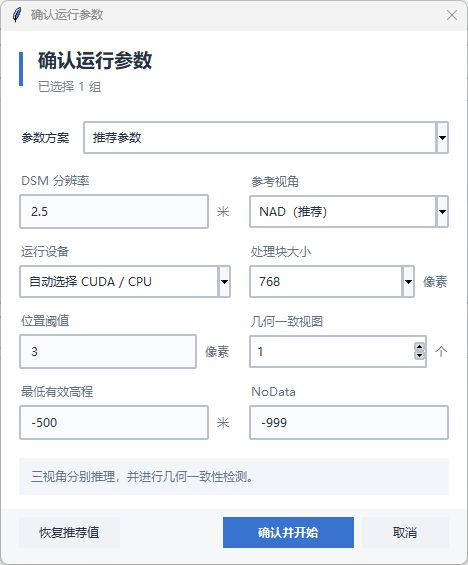

# 资源三号 DSM 生产工具 · Windows 使用指南

[返回首页](../README.md) · [下载 V1.20](https://github.com/Tian8du/Sat_MVSF/releases/tag/desktop-v1.20.0)

## 下载与安装

从 Release 附件下载：

- `ZY3DSM_Desktop_v1.20.0_Windows_x64_Setup.exe`：完整安装包。
- `ZY3DSM_Desktop_v1.20.0_Windows_x64_Setup.exe.sha256`：安装包校验值。

双击安装包，完成安装后，从开始菜单启动“资源三号 DSM 生产工具”。按当前用户安装，无需管理员权限。卸载可在 Windows 的“应用和功能”中进行。

安装包包含桌面程序、C++ 计算引擎、模型、LibTorch/CUDA 运行库及 GDAL/PROJ 数据，无需另装 Python、Conda、CUDA Toolkit、GDAL 或 PROJ。GPU 计算需要系统安装兼容的 NVIDIA 驱动；默认自动选择 CUDA / CPU，也可以在参数窗口指定 CPU。

需要核验下载文件时，在 PowerShell 中执行：

```powershell
Get-FileHash .\ZY3DSM_Desktop_v1.20.0_Windows_x64_Setup.exe -Algorithm SHA256
Get-Content .\ZY3DSM_Desktop_v1.20.0_Windows_x64_Setup.exe.sha256
```

两处 SHA-256 应一致。安装包为 Windows x64 版本，不适用于 Linux 或 ARM。

## 准备数据

每组需要三张资源三号三线阵影像，以及各自的 RPC：

| 视角 | 影像 | RPC |
| --- | --- | --- |
| BWD · 后视 | `.tif` / `.tiff` | 对应的标准 RPC 文本或原始 `.rpb` |
| FWD · 前视 | `.tif` / `.tiff` | 对应的标准 RPC 文本或原始 `.rpb` |
| NAD · 正视 | `.tif` / `.tiff` | 对应的标准 RPC 文本或原始 `.rpb` |

自动扫描时，建议使用共同的场景名和明确的视角标记：

```text
Input/
├── Scene_A/
│   ├── Scene_A_BWD.tif
│   ├── Scene_A_BWD_rpc_std.txt
│   ├── Scene_A_FWD.tif
│   ├── Scene_A_FWD_rpc_std.txt
│   ├── Scene_A_NAD.tif
│   └── Scene_A_NAD_rpc_std.txt
└── Scene_B/
    └── 另一组完整的三视图和 RPC
```

选择 `Input` 可以批量识别，也可以只选择 `Scene_A`。存在多份候选 RPC、同一视角影像重复或视角缺失时，在“数据详情”查看提示；文件名无法可靠配对时，使用“手动选择”逐项指定 BWD / FWD / NAD。

标准 RPC 文本需包含偏移量、归一化尺度及四组各 20 项展开系数。原始 RPB 由前端转换为标准 RPC，再交给计算引擎；转换结果写入结果目录，不写原始数据目录。

## 开始运行

1. 在“输入”行点击“选择文件夹”，等待自动识别完成；或点击“手动选择”。
2. 在“输出”行选择结果文件夹。例如输入为 `D:\ZY3\Input`，结果可设为 `D:\ZY3\Results`。两者不能相同，也不能互相包含。
3. 检查就绪状态和识别的组数。存在跳过提示时，在“数据详情”确认原因。
4. 点击“开始”，在“确认运行参数”窗口选择方案或修改参数。
5. 点击“确认并开始”。点击“取消”返回主界面，不会启动计算。

<p align="center">
  
</p>

### 处理模式

| 方案 | 工作方式 |
| --- | --- |
| 推荐参数 | 标准模式，三视角分别推理，再进行几何一致性检测。 |
| 极简模式 | 三视图共同作为输入，每块只以 NAD 为参考推理一次，跳过几何一致性检测。NAD 参考固定，几何检测参数禁用。 |
| 2 米输出网格 | 标准模式，DSM 输出像元尺寸设为 2 米。 |
| 5 米输出网格 | 标准模式，DSM 输出像元尺寸设为 5 米。 |

极简模式减少了推理和过滤步骤，也减少了几何一致性约束；应根据具体影像和成果用途检查结果。

### 参数说明

| 参数 | 默认值 | 含义与可选范围 |
| --- | --- | --- |
| DSM 分辨率 | 2.5 米 | 输出网格的像元尺寸，允许 0.1–100 米；不代表高程精度。 |
| 参考视角 | NAD | 可选 BWD、FWD、NAD；极简模式固定 NAD。 |
| 运行设备 | 自动选择 CUDA / CPU | 可手动选择 CUDA 或 CPU；显式选择 CUDA 时需有可用设备。 |
| 处理块大小 | 768 像素 | 可选 512、768、1024；影响块数量、单块计算及内存／显存占用。 |
| 位置阈值 | 3 像素 | 几何一致性检查的位置误差阈值，允许 0.1–100；极简模式不使用。 |
| 几何一致视图 | 1 | 一致性检查要求的视图数，可选 1 或 2；极简模式不使用。 |
| 最低有效高程 | −500 米 | 低于该值的结果不作为有效高程；应按数据区域选择。 |
| NoData | −999 | 无效栅格的标记值，应与需要保留的有效高程区别。 |

当前桌面版按影像覆盖范围自动选择 UTM，输出分辨率的单位为米。此窗口没有 WGS84 经纬度输出开关。

## 查看过程与结果

主界面的流程依次为：

**裁剪影像 → 立体匹配 → 过滤噪点 → 生成点云 → 生成 DSM**

- 整批进度显示已处理的数据组数和成功／失败状态。
- 展开“各组进度”，再展开组名，可以查看这一组各阶段的进度和耗时。进度来自实际工作计数；标注“约”的组进度不是剩余时间预测。
- “详细日志”保留引擎输出；“数据详情”显示输入配对及异常提示。
- 在“结果预览”切换已完成成果，也可点击“载入 TIFF”查看已有 DSM。程序按窗口尺寸生成高程彩色缩略图，不改变原始 TIFF 的高程、坐标系和 NoData。
- “打开目录”用于查看结果文件。

最终 DSM 直接放在所选结果文件夹下：

```text
Results/
├── scene_a_DSM.tif
├── scene_b_DSM.tif
├── 每组订单、日志与小型完成记录
└── 未完成组的工作区缓存
```

组名由影像名称规范化生成；存在重名时加入区分标识，避免覆盖其他数据组。最终文件为带地理参考的 GeoTIFF，默认 NoData 为 `-999`。

## 停止、续跑与缓存

点击“停止”后，未完成组保留中间结果。再次选择相同输入、相同结果目录和相同处理参数，程序会检查并复用有效缓存。已经完成的阶段可能很快跳过，这属于成果复用。

**每组 DSM 成功交付并通过文件读取校验后，程序会自动清理该组的大体积中间文件，再处理下一组。**保留最终 DSM、订单、日志和必要的完成记录。失败或停止的组保留缓存，以便再次运行。

“删除缓存”按钮用于重试本次会话已成功组的清理。清理前会显示可释放的空间；运行中的工作区不允许清理。

已有有效的最终 DSM 会优先复用，即使本次修改了参数也会跳过该组。**需要用新参数重新计算时，先将该组最终 DSM 移出结果目录，再开始处理。**缓存已经清理的组需要重新计算。请避免同时用多个程序操作同一组结果目录。

## 常见问题

| 问题 | 检查方法 |
| --- | --- |
| “开始”按钮不可用 | 确认输入已识别为完整三视图，且已选择独立结果目录。 |
| 没有识别到数据组 | 检查 BWD / FWD / NAD 文件名标记、同名场景和 RPC 配对；使用“手动选择”确认六个文件。 |
| 自动改用 CPU | 在参数中核对运行设备，检查 NVIDIA 驱动与 CUDA 可用性。 |
| 再次运行立即完成 | 检查是否已有有效 DSM 或有效阶段缓存；如需重算，按上文移走最终 DSM。 |
| DSM 有空洞或异常高程 | 结合原始影像检查云、水面、弱纹理、遮挡与 RPC 情况；内置预览和文件校验不等于测高精度验证。 |
| 空间不足 | 停止任务后检查结果盘剩余空间；未完成组的缓存需要保留用于续跑。 |

报告问题时，可在 [Issues](https://github.com/Tian8du/Sat_MVSF/issues) 提供软件版本、Windows／GPU 信息、所用模式、出错阶段及相关日志。共享日志或截图前请移除不希望公开的路径和项目信息。

## 版本与许可

本页对应 Windows 桌面版 V1.20，不包含 Linux ARM 或分布式 Prepare / Block / Merge 执行体。Python 源码用法见 [Python 管线说明](python-pipeline.md)。

桌面前端与 C++ 工程源码不随此 Release 公开。仓库已有 Python 源码仍按 [MIT License](../LICENSE) 发布；随包模型和第三方软件适用各自许可，详见发布附件和安装目录中的说明。
